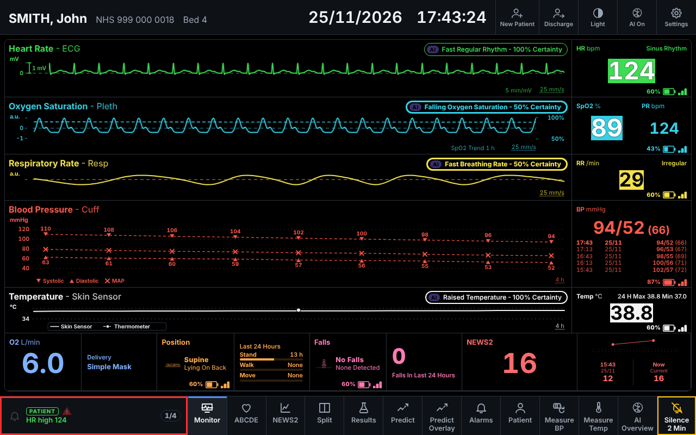
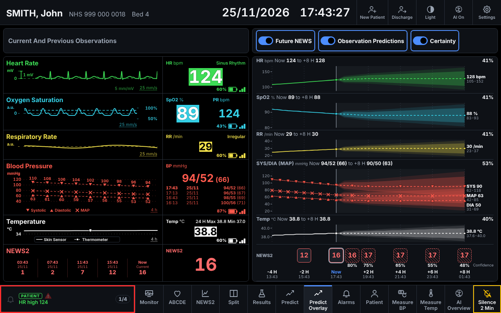
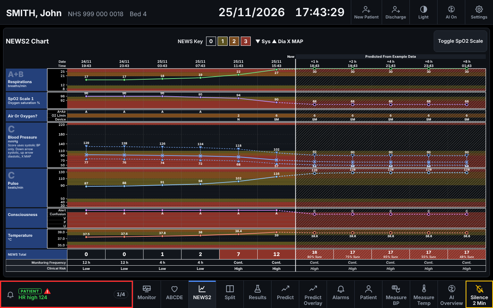
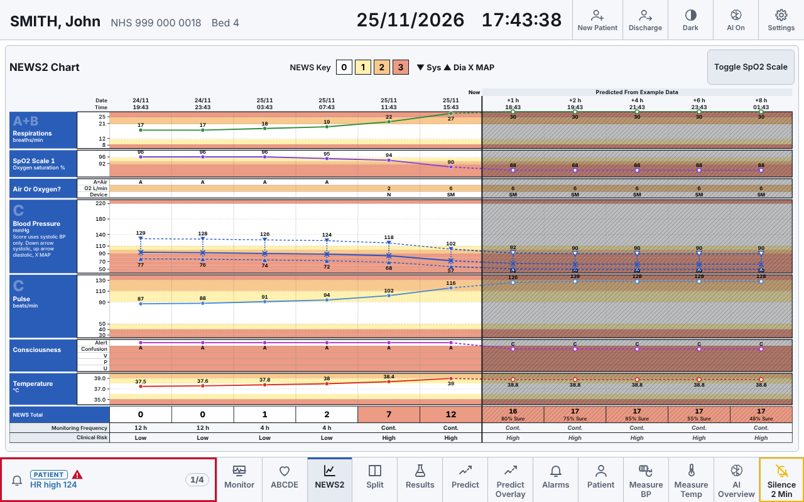
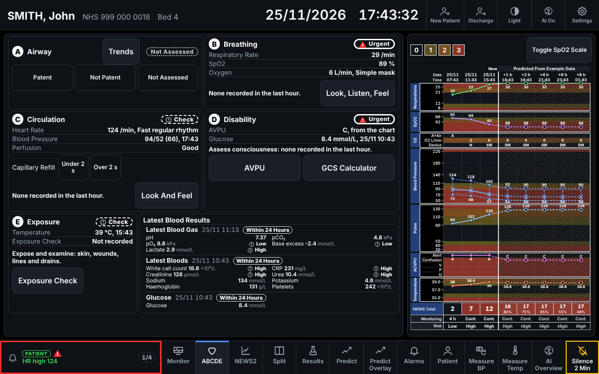
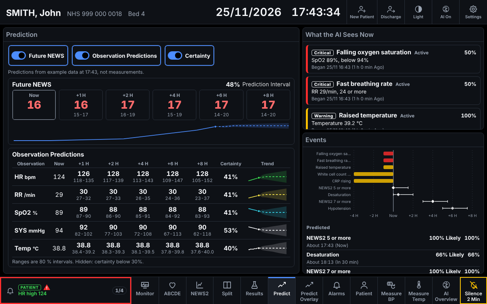
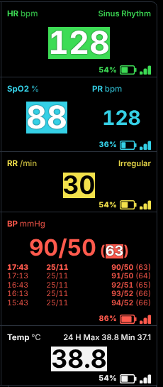
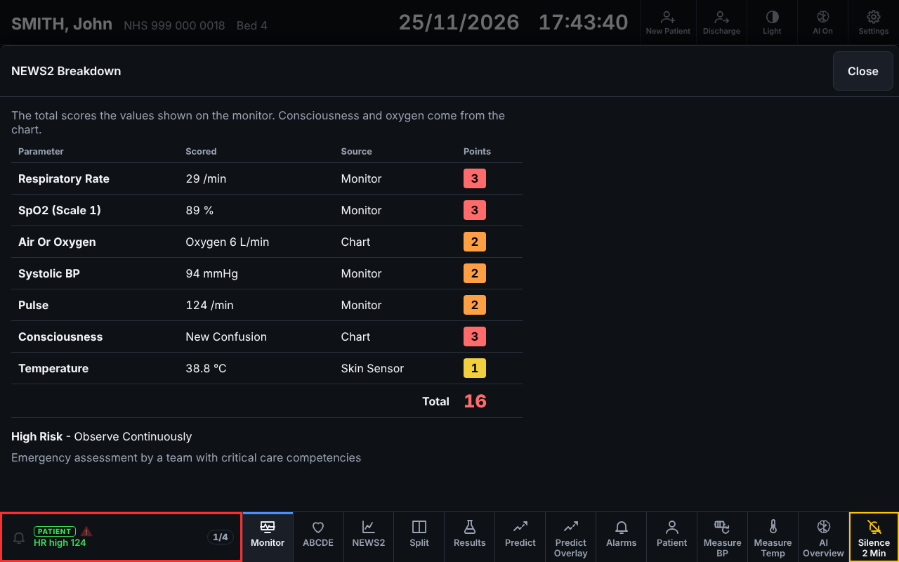
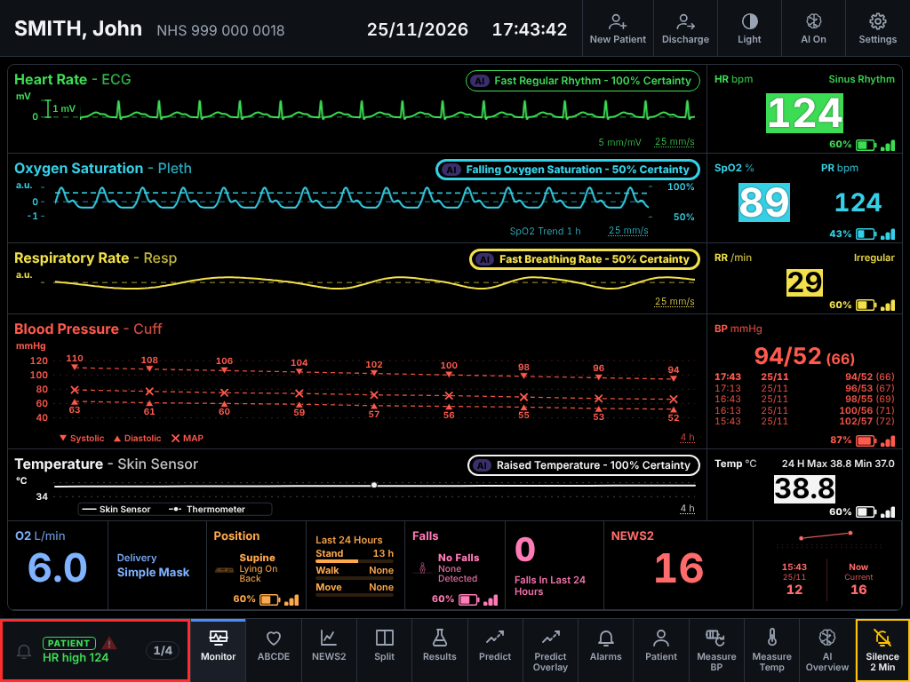

# EMUS-2 co-design patient monitor

A touch-first patient monitor for co-design workshops with doctors and nurses. It
starts from two familiar displays, an ICU bedside monitor and the RCP NEWS2 chart,
and lets people redesign every part of the screen by hand or by asking a chatbot,
with each change saved as a version. It is the front end for a causal AI model
that predicts complications some hours ahead.

**This is a prototype for design workshops. It is not a medical device and must
not be used for patient care.** Data is simulated or from the open-access MIMIC-IV
demo, and AI findings and forecasts are placeholders until the causal model is
connected.

## Screenshots

All from example data (a pneumonia case at the point where it is getting worse), not patients. They are regenerated with `make screenshots`.

**The monitor.** Traces and number boxes by row; a number in alarm is a box in its own colour, flashing; the notification box at the bottom left.



**Prediction overlay.** The monitor on the left, the predicted trends to +8 hours on the right, level row for row, with NEWS2 in boxes along the bottom and a confidence under each prediction.



**NEWS2 chart.** The observed columns, then the predicted ones in the same chart, darker and thinly hatched so they cannot be mistaken for charted values.





**ABCDE.** Cards in reading order with look, listen and feel checks, and the latest blood gas, bloods and glucose.



**Prediction tab.** The forecast, what the AI sees now, and the events timeline.



**Alarm highlight and the NEWS2 breakdown.** Systolic, diastolic and MAP highlight separately (here only the MAP, 63); touching the NEWS box shows how the total is made.




**A smaller screen (1024 x 768).**



## Status

The scaffold (milestone 1) is in place: the design schema, clinical registry,
NEWS2 scoring, data contracts, patch validation, SQL schema, and a shell that
renders the default designs. Milestones M2 to M8 are specified with briefs,
acceptance tests and agent workflows, and are not built yet. See
[`docs/HANDOFF.md`](docs/HANDOFF.md).

## Run it

Needs Python 3.11 or newer and Node 20 or newer.

```bash
make setup
```

```bash
make dev
```

Open the Vite address it prints (port 5173). For tablets on the same network, use
one server instead:

```bash
make serve
```

and open `http://<this-computer>:8000` on the tablet.

Checks:

```bash
make test
```

```bash
make e2e
```

(`make e2e` needs `make serve` running in another terminal.)

## How it fits together

```
backend/app/
  registry.py        read-only clinical vocabulary: parameters, codes, UK ranges
  models/design.py   the design document: the only thing redesign can change
  models/clinical.py data contracts: observations, findings, forecasts, certainty
  news2.py           NEWS2 scoring
  patching.py        applies and validates design edits (the chatbot boundary)
  scenarios.py       scripted simulated patients
  sources/           device adapters: simulator, MIMIC replay, ANNE One (stub)
  signal_quality.py  is this trace good enough to trust?
  ai/                interpretation, forecaster, certainty, LLM providers
  interop/           FHIR R4 and HL7 v2 mapping
  routers/           HTTP and WebSocket API
frontend/src/
  design/            generated types, theme to CSS variables, navigation
  layout/            top bar, bottom tabs, menus, sheets, split layouts
  safety/            tiles (a number or why there is none), the notification ticker
  traces/            baseline, scale and calibration marks drawn on every trace
  widgets/           what goes in a pane: the monitor grid of modules, NEWS2 chart, labs ...
  layout/grid.ts     packs modules of different sizes into a grid that fills the pane
  studio/            sheets: clinical panels and design-studio sections
docs/
  HANDOFF.md              what is built, what is next, the rules
  briefs/                 one brief per milestone
  human-factors.md        how failure modes are told apart; alarm and device states
  forecast-options.md     forecast displays and certainty metrics to choose from
  causal-model-contract.md  how to connect the causal model
.claude/workflows/   agent workflows that implement each milestone
```

**The screen is data.** Everything visible is drawn from one JSON design document:
theme, screens and split layouts, rows, tabs, menus, alarm defaults, and how AI
findings and forecasts are shown. Editing by touch, editing by chat and version
history all act on that document. It refers to clinical items only by id; the
items themselves live in the read-only registry, so a redesign cannot alter data
structures. A few things cannot be designed away: the patient's name, the clock,
the alarm-silence button (always two minutes), the settings button, the
notification box, and the warnings that say the monitoring itself has a problem.

## Example data and AI

With no live feed yet, the monitor shows **example data**: scripted scenarios at a chosen
minute (Settings, Demo Controls), with synthesised ECG, pleth and respiration, labelled
EXAMPLE DATA everywhere. The AI chip on each module says what the interpretation found and
how sure it is; brackets on the trace say why. The interpretation is a short, readable
rule over the synthetic signal (not a clinical model) so each finding can be explained.
The AI button in the top bar turns every AI mark off for the screen.

## ABCDE and the NEWS2 chart

The **ABCDE** tab checks Airway, Breathing, Circulation, Disability and Exposure from the monitor's data and a few prompts, then shows the latest blood gas, bloods and glucose with when they were taken, a Trends button, and the NEWS2 chart on the other half of the screen. Airway, capillary refill, AVPU, GCS and exposure are recorded on the screen only.

The NEWS2 chart is drawn like the printed Royal College of Physicians chart, filled in: blocks for Respirations, SpO2 (Scale 1 or 2, with a Toggle SpO2 Scale button), Air or Oxygen, Blood Pressure, Pulse, Consciousness and Temperature. The numeric blocks are continuous y axes (a value sits at its true height, with a few ticks down the side) over bands coloured by score (white 0, yellow 1, orange 2, red 3) at their true widths; Air or Oxygen and Consciousness stay as labelled rows. Each value is a dot joined by a line, and the total, monitoring frequency and clinical risk underneath. Blood pressure is the systolic dot with a dotted tail to the diastolic number and an X at the MAP. It follows the light or dark theme (`news_bands` colours). The bands and axes come from `NEWS2_BANDS` and `NEWS2_AXES` in `backend/app/news2.py`, which the tests check against the scoring functions (bands tile each axis; ticks are at most half the printed rows).

Blood pressure on a trend is a dot at the MAP with a tail from diastolic to systolic, the systolic number above the tail and the diastolic below (written once as "sys/dia" above the tail when the graph is too short for two). Every trace, small modules included, has its x scale as a number you can tap; a small module's is a time window. Lines and numbers stay inside their graph, above a strip kept for the x scale.

## Customising the screen

Settings, then **Edit Layout**: tap a module, choose its size from seven pictured shapes (small
square to double-height row), move, copy or remove it, change what it measures, its name, colour
and content, and turn its AI off. **Appearance**, **Tabs and Menus** and **AI and Certainty** change
the rest. Changes show at once and are saved as a new version with your name and a note;
**Versions** keeps the history, reverts, copies, exports and imports.

## Data and standards

- The monitor is a grid of modules: a small square, a tile (number and trend), tall, wide,
  large, a full row, or a double-height full row. The built-in "Modular Example" design
  shows them all.
- Simulated scenarios: pneumonia with deterioration, paroxysmal AF, COPD on SpO2
  scale 2 with a fall, non-sustained VT with critical potassium, a stable patient,
  and a well patient with monitoring problems (standby, low battery, poor trace,
  sensor off, connection lost).
- MIMIC-IV Clinical Database Demo v2.2 (open access) via `make mimic` (milestone M6).
- Target device: Sibel ANNE One (ECG, HR, RR, SpO2, pulse, skin temperature,
  position, activity, falls). The adapter is a documented stub until SDK access.
- FHIR R4 and HL7 v2 interfaces are milestone M8. Clinical codes marked provisional
  in `registry.py` need checking against a terminology server before real use.

## Monitor screen (round 7)

The monitor is five full-width traces (ECG, SpO2, respiration, blood pressure, temperature) and then one line of four small boxes: O2 flow, activity, falls and NEWS2. **Height** of any module is set in Edit Layout (Shorter, Standard, Taller, Tallest, Double; saved in the design as `height_scale`); ECG, SpO2, BP and the bottom line start a little taller and the ECG gain starts at 5 mm/mV.

- **Blood pressure** on the trace is a down arrow (systolic), an up arrow (diastolic) and an X (MAP), each joined by dashes, with a key and five values on the scale. The tile shows the diastolic as large as the systolic.
- **Boxes** show the rhythm in words under the HR, Regular or Irregular for breathing, the 24 h high and low temperature, falls in the last 24 hours, time standing, walking and moving, and the NEWS2 total over time and by date and time. These come from the example snapshot (`falls_24h`, `activity_24h`, `extremes_24h`, `rhythm`, `resp_pattern`).
- **Measure BP** and **Measure Temp** tab buttons run a simulated reading (`GET /api/examples/{scenario}/measure`), added to the list, trend and tile until the time changes. It is marked simulated and reaches no record.

## Dates, predictions and measuring (round 8)

- **Date and time formats** are a setting (Settings, Appearance, Date And Time): date as 24/11/2026 (default), 11/24/2026, 2026-11-24 or 24 Nov 2026; 12 or 24 hour time; seconds; and whether the date sits beside the clock. Every date and time on screen follows it (`design/datetime.ts`); exports keep ISO.
- **Prediction view** (the Predict tab): future NEWS for each horizon with its 80 % range and a chart running into the prediction, and a table of predicted heart rate, respiration, SpO2, systolic BP and temperature, each with certainty. Three switches (Future NEWS, Observation Predictions, Certainty) turn each part on or off; the choice is kept on the screen. The predictions are from example data until the causal model (M7) is connected.
- **Last five BP readings** sit under the BP number in the main view; the number takes the room the list leaves and the oldest lines drop out where the row is short.
- **Measure BP / Measure Temp** are one-touch: the first touch starts a simulated measurement and the box for it pulses until the reading is in; the next touch cancels it. No sheet or menu opens.
- **Red emergency alerts** are a red triangle with an exclamation mark, not repeated exclamation marks: priority is shown by shape and word (red triangle, amber triangle, circled "!"), and Urgent and Critical use the red triangle.

## Prediction overlay, the full Prediction tab and the NEWS2 check (round 9)

- **Prediction Overlay** is a tab button (one touch on, one touch off, back to the screen you were on). The monitor (traces and number boxes, with the last five BP readings, then NEWS2) fills the left half; the right half is level with it, one predicted chart for each monitor row and the NEWS2 total in boxes over time along the bottom, showing the **predicted trends** on one shared time axis from 4 H back to **+8 H** ahead: the future NEWS over time (charted totals solid, predicted total dashed with 50/80/95 % intervals, risk lines at 5 and 7) and heart rate, respiration, SpO2, systolic BP and temperature, each with its history, prediction, intervals and certainty. The three switches are the Prediction view's own. Screen id `monitor-predict`, widget `prediction-trends` (`back_hours`, `ahead_hours` up to 8).
- **The Prediction tab** now has all three panels: the forecast, **What the AI Sees Now** (findings with severity, certainty and onset; a touch opens the Why sheet) and an **Events** timeline (what the AI found, and the predicted NEWS2 5 and 7, desaturation and hypotension with their earliest and latest times, probability and certainty).
- **Forecasts** now have a point every 30 minutes to 8 hours. Intervals are kept inside what the measure allows (NEWS2 0 to 20, saturation to 100 %). Past the end of a scripted scenario the last scripted state is held, so predictions flatten there; that is an example-data limit, not the model.
- **NEWS2 check:** the NEWS2 total, and the forecast, now score the temperature that is displayed (the continuous skin reading), so the total is always the NEWS2 of the numbers on screen (16 for the pneumonia example at minute 360, not 17). Charted observation sets keep their thermometer values. **Touch the NEWS box** to open the NEWS2 Breakdown: each parameter with the value scored, its source, its points, the total, the risk and the monitoring response. The scoring rules themselves are unchanged and tested against the RCP chart.

## Alarm highlight, confidence, BP prediction and the NEWS2 overlay (round 10)

- **A value in alarm** is drawn as a box of the observation's own colour with white digits (dark digits only where the colour is itself near white, such as the temperature row), alternating with the normal coloured number. Square corners; the box is the number's own box, so it moves and overlaps nothing. Systolic, diastolic and MAP each follow their own alarm (diastolic and MAP now have alarms: DIA 40 to 110, MAP 65 to 120), together or alone; every parameter works the same way. One shared clock keeps all flashing numbers in step: high priority 0.5 s on / 0.5 s off, medium 1 s, low 2 s (never more than one flash a second); with reduced motion the highlight is held. Silencing the sound does not stop it; an alarm switched off for a parameter does.
- **Confidence under each predicted NEWS2 box** on the overlay (and under each predicted total on the NEWS2 overlay): each forecast point now carries its own certainty (`ForecastPoint.certainty`), which falls with the horizon. It follows the Certainty switch.
- **BP prediction** now shows systolic, MAP and diastolic like the monitor's BP trend (▼ ✕ ▲, measured readings dotted, predicted lines dashed with 80 / 95 % bands, three end values spread so they never touch). `bp_dia` and `bp_mean` are forecast beside `bp_sys`, kept in order.
- **Predicted NEWS2 in the same chart:** every NEWS2 chart (NEWS2, split, ABCDE) shows the observed columns, then a column for each forecast horizon (`show_future`, from `predicted_obs_sets`) with every parameter's predicted value, the total, its risk and % confidence. The prediction is unmistakable: a darker region with thin diagonal hatching over the score colours, dashed trends, hollow markers, a Now divider and a "Predicted From Example Data" banner. The Predict Overlay button on the NEWS2 screen opens the same chart full width. Other screens keep the monitor overlay.
- Fixed: the red triangle's exclamation mark had been pushed out of the triangle by a style name shared with the time axis.

## ABCDE: look, listen and feel (round 12)

- **Breathing** has a Look, Listen, Feel sheet (chest expansion, work of breathing, trachea, percussion including hyper-resonant, air entry, added sounds) and **Circulation** a Look And Feel sheet (oedema, skin, pulse, neck veins). Each touch is recorded with its time on this screen only (never changing NEWS2), shown under the section, and abnormal answers raise the letter to Check or Urgent and bring a prompt (for example unequal expansion with hyper-resonance: think pneumothorax). The note above A has gone.
- **D, E and the latest blood gas, bloods and glucose are in view**: A, B and C in the left column, D, E and the results in the right, compact; the ABCDE panel now takes about two thirds of the screen, the NEWS2 chart the rest.
